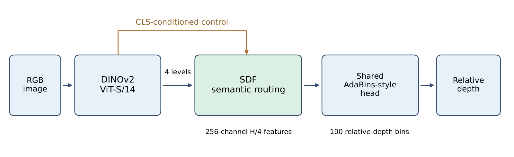
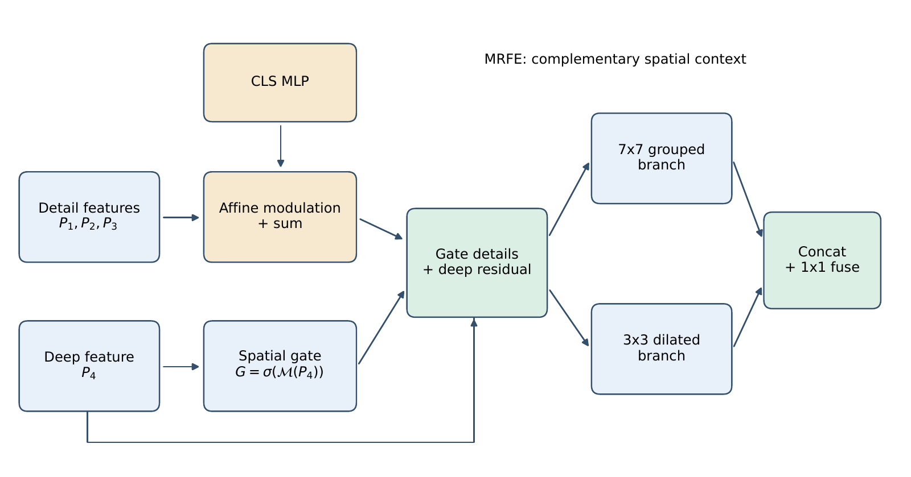

# NearDepth

**Semantic-Driven Feature Decoding for Efficient Close-Range Monocular Depth Estimation**

NearDepth estimates relative depth in close-range scenes. Its Semantic-Driven Feature Decoder (SDF) uses the CLS token to modulate detail channels and the deepest feature map to gate detail at each spatial location. Multi-receptive-field enhancement and dynamic upsampling combine context and detail on compact grids. The main experiments compare SDF and Simple Fusion with the same DINOv2 ViT-S/14 backbone and AdaBins-style prediction-head design.

## Architecture

## Results

### Accuracy across five training seeds

Paper Table 8 reports aligned image-macro AbsRel (mean ± sample standard deviation). Positive paired differences favor SDF.

| Test set | Simple ↓ | SDF ↓ | Simple − SDF [paired 95% CI] |
| --- | ---: | ---: | ---: |
| GraspNet Novel | 0.05940 ± 0.00046 | **0.05648 ± 0.00018** | 0.00292 [0.00243, 0.00341] |
| DREDS CatNovel | 0.05387 ± 0.00029 | **0.05207 ± 0.00025** | 0.00179 [0.00145, 0.00214] |
| NYUv2 (all 1,449) | 0.10018 ± 0.00037 | 0.09879 ± 0.00100 | 0.00139 [−0.00026, 0.00305] |

SDF improved AbsRel in all five pairs on both close-range datasets. The mean reductions were **4.9% on GraspNet Novel** and **3.3% on DREDS CatNovel**. At 448 × 448 on an RTX 3060 (FP32, batch size 1), this comparison has a 0.840 ms mean full-model latency cost (24.888 ms for SDF and 24.048 ms for Simple, paper Table 9).

### Full-model latency versus DPT

Paper Tables 5 and 6 compare the tested DPT implementation and SDF with a common DINOv2 ViT-S/14 backbone. Values are mean full-model latency in milliseconds over 1,000 CUDA-event measurements (FP32, batch size 1).

| Input (width × height) | RTX 5090 DPT | RTX 5090 SDF | RTX 3060 DPT | RTX 3060 SDF |
| --- | ---: | ---: | ---: | ---: |
| 320 × 180 | 7.31 | **5.99** | 18.56 | **14.38** |
| 640 × 360 | 13.21 | **10.71** | 65.51 | **52.34** |
| 1280 × 720 | 47.94 | **40.89** | 355.64 | **315.24** |

[Qualitative comparison](assets/main_visual.png)

## Setup

Use Python 3.10 and a CUDA-enabled PyTorch installation for training. Install the project dependencies with:

~~~sh
python -m pip install -r requirements.txt
~~~

Provide a local [DINOv2](https://github.com/facebookresearch/dinov2) source checkout and the matching ViT-S/14 with registers backbone checkpoint. The commands below use `path/to/...` placeholders for local files and folders.

## Data and pseudo-labels

The training manifests expect a shared data root with `GraspNet/`, `DREDS/`, and `Hypersim/` subdirectories. [The manifest archive](neardepth_v2/configs/paper_manifests.zip) contains the six train and validation file lists used by the paper configuration, along with their SHA-256 checksums. Paths beginning with `data://` are resolved relative to the shared data root. Obtain the dataset files from their original providers.

GraspNet uses Depth Pro pseudo-labels for training and native RealSense depth for validation. The label tool uses a local [Depth Pro](https://github.com/apple/ml-depth-pro) source checkout with its dependencies and checkpoint. It writes millimeter depth maps as 16-bit PNG files. The audit tool checks the generated maps against their generation records.

~~~sh
python -m neardepth_v2.data.generate_graspnet_labels --root path/to/data/GraspNet --teacher-src path/to/ml-depth-pro/src --weights path/to/depth_pro.pt --reports experiments_v2/teacher --focal-source estimated
python -m neardepth_v2.data.audit_graspnet_labels --root path/to/data/GraspNet --reports experiments_v2/teacher
~~~

DREDS supplies synthetic axial depth. Hypersim supplies radial distances, which the loader converts to axial depth using per-scene camera metadata.

## Training

Extract the training manifests, generate the 13 paper configurations, then check the prepared data before starting training.

~~~sh
python -m zipfile -e neardepth_v2/configs/paper_manifests.zip manifests/paper_448
python -m scripts.prepare_paper_configs --manifest-root manifests/paper_448 --data-root path/to/data --output experiments_v2/configs/seed_42 --seed 42
python -m neardepth_v2.preflight --config experiments_v2/configs/seed_42/variants/full.json --output experiments_v2/preflight_seed_42.json
python -m neardepth_v2.train --config experiments_v2/configs/seed_42/variants/full.json --backbone-repo path/to/dinov2 --backbone-weights path/to/dinov2_vits14_reg4_pretrain.pth --device cuda
~~~

The paper setup trains for 30 epochs at 448 × 448 with 49,152 samples per epoch, balanced across the three domains. Each run selects `checkpoints/best.pth` by the equal-domain mean of validation image-macro AbsRel. For the five paired runs, generate configurations for seeds 42–46 and train both `full.json` and `simple.json` for each seed. A run created with this release can resume from its `checkpoints/latest.pth` using `--resume`.

## Evaluation

Pass a separate validation or test manifest with ground-truth paths, depth units, and valid depth bounds. The example uses the GraspNet Novel range and the SDF checkpoint from the training command.

~~~sh
python -m neardepth_v2.evaluate --checkpoint experiments_v2/paper_448_full/seed_42/checkpoints/best.pth --manifest path/to/graspnet_novel_test.jsonl --output experiments_v2/eval/graspnet_novel --backbone-repo path/to/dinov2 --backbone-weights path/to/dinov2_vits14_reg4_pretrain.pth --data-root path/to/data --min-depth 0.001 --max-depth 3.0 --device cuda
~~~

The evaluator fits a per-image affine transform with a non-negative scale on valid pixels and writes per-image metrics and summary statistics. For a test record example, inspect the [manifest schema](neardepth_v2/data/manifest.py) and set its split to `test`. This release covers SDF and Simple training and manifest-based evaluation. The paper's DPT benchmark, direct NYUv2 MAT reader, and trained weights are separate artifacts.

## Repository layout

| Area | Location |
| --- | --- |
| Model and losses | [Model modules](neardepth_v2/models/) and [training objectives](neardepth_v2/engine/loss.py) |
| Training, data, and evaluation | [Training](neardepth_v2/train.py), [data](neardepth_v2/data/), [configurations](neardepth_v2/configs/), and [evaluation](neardepth_v2/evaluate.py) |
| Pseudo-label tools | [Generate](neardepth_v2/data/generate_graspnet_labels.py) and [audit](neardepth_v2/data/audit_graspnet_labels.py) GraspNet labels |
| Figures | [Assets](assets/) |

## License

This work is licensed under [CC BY-NC-SA 4.0](https://creativecommons.org/licenses/by-nc-sa/4.0/).
